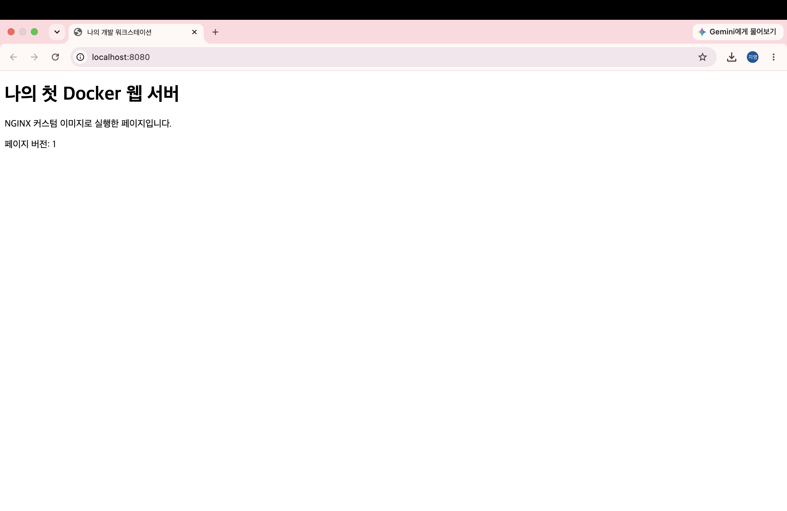

# 개발 워크스테이션 구축

## 1. 프로젝트 개요
터미널, Docker, Git/GitHub를 활용해 개발 환경을 구성하고,
웹 서버 실행·포트 연결·파일 변경 반영·데이터 영속성을 검증한다.

## 2. 실행 환경
- OS: macOS 15.6.1 (Build 24G90)
- Shell: zsh (/bin/zsh)
- 터미널: macOS 기본 터미널 앱
- Docker 버전: 29.8.2 (OrbStack 사용)
- Git 버전: 2.50.1 (Apple Git-155)

## 3. 수행 체크리스트
- [x] 터미널 기본 조작
- [x] 파일·디렉토리 권한 변경
- [x] Docker 설치 및 점검
- [x] hello-world·Ubuntu 실행
- [x] attach/exec 및 컨테이너 종료·유지 관찰
- [x] 이미지·컨테이너 관리, 로그·리소스 확인
- [x] Dockerfile 작성 및 커스텀 이미지 빌드·실행
- [x] 포트 매핑 및 접속 확인
- [ ] 바인드 마운트 변경 반영
- [ ] Docker 볼륨 영속성 검증
- [ ] Git 사용자 정보·기본 브랜치 설정
- [ ] GitHub·VSCode 연동

## 4. 터미널 조작 및 권한 실습
### 수행 내용
- `pwd`: 현재 위치 확인
- `ls -la`: 숨김 파일을 포함한 목록 확인
- `cd`: 디렉토리 이동
- `touch`: 빈 파일 생성
- `echo`와 `cat`: 내용 저장 및 확인
- `cp`: 파일 복사
- `mv`: 이름 변경 및 파일 이동
- `mkdir`: 디렉토리 생성
- `rm`과 `rmdir`: 파일 및 빈 디렉토리 삭제
- `ls -l`, `ls -ld`, `chmod`: 파일·디렉토리 권한 확인 및 변경

### 주요 명령 및 실제 결과 발췌
아래 명령은 전체 로그 중 일부를 발췌한 것이다.

```text
$ pwd
/Users/jiyoung/dev-workstation

$ touch memo.txt
$ ls -l memo.txt
-rw-r--r--  1 jiyoung  staff  0 11  6 05:55 memo.txt

$ echo "My first terminal practice" > memo.txt
$ cat memo.txt
My first terminal practice

$ cp memo.txt memo-copy.txt
$ mv memo-copy.txt memo-renamed.txt
$ mkdir archive
$ mv memo-renamed.txt archive/
$ ls -l archive
total 8
-rw-r--r--  1 jiyoung  staff  27 11  6 05:55 memo-renamed.txt

$ rm archive/memo-renamed.txt
$ rmdir archive

$ mv memo.txt practice/
$ cd practice

$ ls -l memo.txt
-rw-r--r--  1 jiyoung  staff  27 11  6 05:55 memo.txt
$ chmod 600 memo.txt
$ ls -l memo.txt
-rw-------  1 jiyoung  staff  27 11  6 05:55 memo.txt

$ mkdir permission-test
$ ls -ld permission-test
drwxr-xr-x  2 jiyoung  staff  64 11  6 05:58 permission-test
$ chmod 700 permission-test
$ ls -ld permission-test
drwx------  2 jiyoung  staff  64 11  6 05:58 permission-test
```

### 권한 해석
권한 숫자는 소유자·그룹·기타 사용자 순서이며,
읽기(r)=4, 쓰기(w)=2, 실행(x)=1을 더해 표현한다.

- 파일: 644 → 600. 소유자만 읽고 쓸 수 있도록 변경했다.
- 디렉토리: 755 → 700. 소유자만 읽기·쓰기·접근할 수 있도록 변경했다.
- 디렉토리의 실행(x) 권한은 해당 디렉토리를 통과하거나 들어가는 데 필요하다.

### 경로
- 절대 경로: `/Users/jiyoung/dev-workstation/practice`
- 상대 경로: `dev-workstation`에서의 `practice`
- 다른 PC에서는 사용자 이름에 맞춰 `~/dev-workstation`을 사용한다.

### 전체 실행 증거
[터미널 전체 명령 및 출력 로그](01-terminal.txt)

원본 로그에는 터미널 화면 제어 문자가 포함되어 있어,
주요 결과는 위 코드블록에 별도로 정리했다.

## 5. Docker 설치 및 운영### 설치 및 점검
macOS에 OrbStack을 설치·실행한 뒤 Docker CLI와 엔진의 동작을 확인했다.

```text
$ docker --version
Docker version 29.8.2, build 7fc2dff

$ docker info
Client:
 Version:    29.8.2
 Context:    orbstack

Server:
 Server Version: 29.8.2
 Operating System: OrbStack
 OSType: linux
 Architecture: aarch64
```

위 출력은 전체 결과 중 주요 항목을 발췌한 것이다.

### hello-world 실행
```text
$ docker run --name hello-test hello-world
Hello from Docker!
```

`docker ps -a`에서 hello-test의 `Exited (0)`을 확인했다.
메시지 출력 후 정상 종료된 상태다.

### Ubuntu 내부 명령 실행
```text
$ docker run -it --name ubuntu-practice ubuntu:24.04 bash

# ls
bin   dev  home  media  opt   root  sbin  sys  usr
boot  etc  lib   mnt    proc  run   srv   tmp  var

# echo "Inside Ubuntu container"
Inside Ubuntu container

# cat /etc/os-release
PRETTY_NAME="Ubuntu 24.04.5 LTS"
```

`#`는 컨테이너 내부, `$`는 맥 터미널의 명령을 구분한 표시다.
OS 정보는 첫 줄만 발췌했다.

### exec와 attach 비교
다음 순서로 명령을 실행하고 상태를 관찰했다.

```text
# exit
$ docker ps -a
$ docker start ubuntu-practice
$ docker ps
$ docker exec -it ubuntu-practice bash
# exit
$ docker ps
$ docker attach ubuntu-practice
# exit
$ docker ps -a
```

| 관찰 상황 | 결과 |
|---|---|
| 최초 실행한 bash에서 exit | Exited (0) |
| exec로 별도로 연 bash에서 exit | Up 상태 유지 |
| attach로 연결한 주 실행 bash에서 exit | Exited (0) |

컨테이너의 생존 여부는 주 프로세스의 실행 여부에 달려 있다.
exec는 새 프로세스를 실행하고, attach는 기존 주 프로세스의 입출력에 연결한다.

### 이미지 및 운영 상태 확인
```text
$ docker images
IMAGE                ID             DISK USAGE   CONTENT SIZE   EXTRA
hello-world:latest   c567b231f656       18.5kB         10.3kB    U
ubuntu:24.04         fe81560990fa        139MB         30.9MB    U

$ docker logs hello-test
Hello from Docker!

$ docker start ubuntu-practice
ubuntu-practice

$ docker stats --no-stream ubuntu-practice
CONTAINER ID   NAME              CPU %     MEM USAGE / LIMIT     MEM %     NET I/O         BLOCK I/O    PIDS
2283c6cb75f2   ubuntu-practice   0.00%     1.441MiB / 7.816GiB   0.02%     1.13kB / 126B   3.6MB / 0B   1

$ docker stop ubuntu-practice
ubuntu-practice
```

로그 출력은 첫 메시지만 발췌했다.

마지막 `docker ps -a`에서 ubuntu-practice는 `Exited (137)`로 표시됐다.
중지는 완료됐지만 종료 코드 0의 정상 종료와 구분해 기록한다.
이 로그만으로 강제 종료에 이른 상세 원인은 확정할 수 없다.

### 전체 실행 증거
[Docker 전체 명령 및 출력 로그](02-docker.txt)버전·데몬 점검, 컨테이너 실습 및 운영 명령의 결과를 기록한다.

## 6. Dockerfile 기반 웹 서버

### 소스코드
- [웹 페이지](app/index.html)
- [Dockerfile](Dockerfile)

### 베이스 이미지와 커스텀 목적
`nginx:stable-alpine`을 선택했다.
정적 HTML을 제공하는 NGINX와 경량 Alpine Linux를 기반으로 한다.

- LABEL: 이미지에 프로젝트 이름을 기록한다.
- COPY: 기본 페이지 대신 직접 작성한 HTML을 제공한다.
- EXPOSE: 컨테이너에서 사용하는 80번 포트를 명시한다.
  실제 호스트 포트 연결은 실행 시 `-p`로 설정한다.

### Dockerfile
```dockerfile
FROM nginx:stable-alpine
LABEL org.opencontainers.image.title="jiyoung-workstation-web"
COPY app/ /usr/share/nginx/html/
EXPOSE 80
```

### 이미지 빌드
저장소 최상위 폴더에서 실행한다.

```text
$ docker build -t workstation-web:1.0 .
[+] Building 7.3s (7/7) FINISHED
```

빌드 출력은 완료 부분을 발췌했다.
현재 폴더를 빌드 컨텍스트로 사용해 `workstation-web:1.0` 이미지를 만들었다.

## 7. 포트 매핑 및 접속

### 컨테이너 실행
```text
$ docker run -d --name workstation-web -p 127.0.0.1:8080:80 workstation-web:1.0
51293396e4a9073230a44410dd6607a758ac52758bf39a829febcbb5d5964c4b
```

호스트의 127.0.0.1:8080을 컨테이너의 80번 포트에 연결했다.
컨테이너의 웹 서버에 맥 브라우저에서 접근하기 위한 설정이다.

`docker ps` 결과에서 다음을 확인했다.
- 상태: Up 4 seconds
- 포트: 127.0.0.1:8080->80/tcp
- 컨테이너 이름: workstation-web

### curl 검증
```text
$ curl http://localhost:8080
<!DOCTYPE html>
<html lang="ko">
<head>
  <meta charset="UTF-8">
  <title>나의 개발 워크스테이션</title>
</head>
<body>
  <h1>나의 첫 Docker 웹 서버</h1>
  <p>NGINX 커스텀 이미지로 실행한 페이지입니다.</p>
  <p>페이지 버전: 1</p>
</body>
</html>
```

### 브라우저 검증
`http://localhost:8080`에 접속해 직접 작성한 페이지가 표시되는 것을 확인했다.



### 전체 실행 증거
[빌드·실행·접속 명령과 출력 로그](03-web.txt)

### 재실행 참고
같은 이름의 컨테이너가 이미 있다면 새로 생성하는 대신
`docker start workstation-web`으로 시작한다.
8080 포트는 다른 프로그램이 사용하지 않는 상태여야 한다.

## 8. 바인드 마운트
실행 명령과 호스트 파일 변경 전후의 반영 결과를 기록한다.

## 9. 볼륨 영속성
볼륨 생성·연결 명령과 컨테이너 삭제 전후의 데이터 확인 결과를 기록한다.

## 10. Git 및 GitHub·VSCode 연동
Git 설정 명령과 결과, GitHub·VSCode 연동 증거를 기록한다.

## 11. 재현 방법 및 증거 링크
평가자가 따라 할 실행 절차와 각 로그·캡처의 위치를 정리한다.
개인 PC에 종속된 경로나 설정은 대체 방법을 함께 설명한다.

## 12. 트러블슈팅

### 사례 1
- 문제:
- 원인 가설:
- 확인:
- 해결 또는 대안:

### 사례 2
- 문제:
- 원인 가설:
- 확인:
- 해결 또는 대안:
